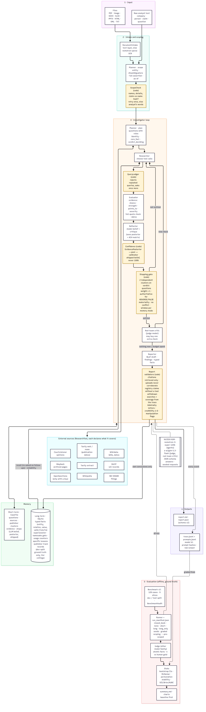
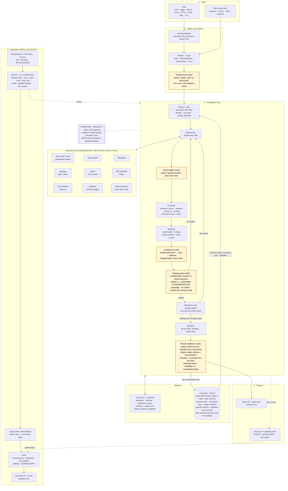

# Architecture

Rendered (PNG and SVG) from the Mermaid source below, `docs/architecture.mmd`. Yellow boxes are rules enforced in
typed code; white boxes are model calls. Every decision that matters to an analyst (when to stop, how confident to
be, what a report may claim) is a yellow box.

## Responsibilities

| Component | Owns | Never does |
|---|---|---|
| `Planner` + `ScopeCheck` | scoping raw text into entity, disambiguators, full assertion and as-of date; the questions and their roles | dropping a name, a disambiguating detail or the claim itself (code retries once, then falls back to the analyst's words) |
| `Researcher` + `QueryLedger` | choosing tools and arguments for open questions | repeating a query: the ledger rejects it in every memory mode |
| `Evaluator` + `QuoteCheck` | turning sources into `Evidence` with stance, strength, verdict direction, severity, date | trusting a quote it cannot find in full in the source (demoted to weak, marked unverified) |
| `Reflector` | the model's belief, critique, follow-ups, distrusted memories, conclude/continue | setting the shipped confidence or stopping on its own |
| `EvidencePosterior` + `ConfidenceCalibrator` | the shipped belief: verdict from a pool of model and posterior; confidence from the posterior (or a dev-fitted calibrator), never 100% | using the model's verbalised probability as the output |
| `CaseFile.unmet_conditions` (the gate) | when a case may close: independent clusters on verdict questions, weight, authoritative sources, materiality, conflicts, all inside the memory mode's window | counting identity confirmations as corroboration of a verdict |
| `Critic` (judge model) | one red-team pass before closing; may buy one extra check | running more than once per investigation |
| `Reporter` + `Report.assemble` | prose and draft findings; then code adds searches, coverage, Admiralty letters, credibility, manipulation flags, minor adverse items | citing unretrieved sources or the analyst's own upload; claiming a registry was checked when no tool covers it |
| `Investigator` | loop, budget, concurrency, trace | any business decision |
| `LongTermMemory` | typed temporal facts with supersession, namesake gate, usage counters, specific lessons, publisher track records | learning track records from its own conclusions (only from dev-split labels or an analyst), exceeding a tier's ceiling |
| `ClosedBookInvestigator` | the floor: same model and rubric, no tools, graded identically | searching |
| `BenchmarkRunner` + `RunManifest` | modes × seeds × cases, graded scoping, resume within one code version | mixing results from two SHAs in one directory |
| `Scoreboard` + `stats` | CIs, paired tests against the closed-book floor, stability, calibration of three confidence signals | reporting a rate without its interval |
| `Transport` | retries, concurrency cap, separate LLM and search caches | |
